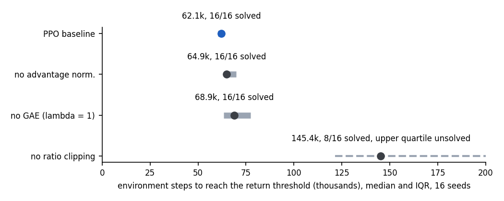

# ppo-from-scratch

PPO written from scratch on a hand-written cart-pole, measured against an LQR controller solved in closed form: both reach 500.0, but PPO spends 62,144 environment steps (median, 16 seeds) and its recovery basin is half the LQR's.



| method | metric | value | condition |
|---|---|---|---|
| sign-projected LQR | mean return, 100 consecutive episodes | **500.0** | 0 environment steps, steps-to-threshold 0 |
| PPO baseline (discrete) | steps-to-threshold, median | **62,144** | IQR [60,442, 63,448], 16/16 solved, 150k budget |
| **no ratio clipping** | steps-to-threshold, median | **145,368 (2.34x)** | **8/16** solved, p 0.0001 |
| LQR vs PPO basin | critical `theta_dot0` | **2.169** vs 1.082 rad/s | PPO median over 16 seeds, best 2.004 |
| PPO continuous (Gaussian) | steps-to-threshold, median | **63,748** | IQR [62,008, 65,636], 16/16, 2.6% over discrete |

Only ratio clipping matters (2.34x without it); the basin gap is the negative finding. No gymnasium, no RL library, no scipy. Every table, the ablations and the MuJoCo step: [docs/DETAILS.md](docs/DETAILS.md). Walkthrough: https://aungkaung1928.github.io/projects/ppo-from-scratch.html

## Quick start

Linux, Python 3.10+ (Ubuntu: the `python3-venv` package), CPU only, one core.

```bash
git clone <this repo URL>
cd ppo-from-scratch
python3 -m venv .venv && . .venv/bin/activate                       # first time only
pip install torch --index-url https://download.pytorch.org/whl/cpu   # first time only
pip install -r requirements.txt                                     # first time only
python lqr.py              # LQR baseline, ~5 s on an idle core: 866 Riccati sweeps, 7 checks
python ppo.py --seed 0     # one 150k-step PPO run, ~11 s on an idle core, greedy eval 500.0
python test_readme.py      # README numbers vs runs/*.json, prints 'all passed'
```

Seed study, ablations, basin comparison and the MuJoCo step: [docs/DETAILS.md#running](docs/DETAILS.md#running).

## How it works

1. `cartpole.py`: the plant in numpy, checked against an independent Lagrangian solve to 2.6e-15.
2. `lqr.py`: linearise, iterate the Riccati recursion, project the gain onto two actions.
3. `ppo.py`: PPO with GAE, ratio clipping and advantage normalisation; `study.py` runs 16 seeds per ablation.
4. `compare.py`: the largest initial velocity each controller recovers from.

## License

MIT, see LICENSE.
